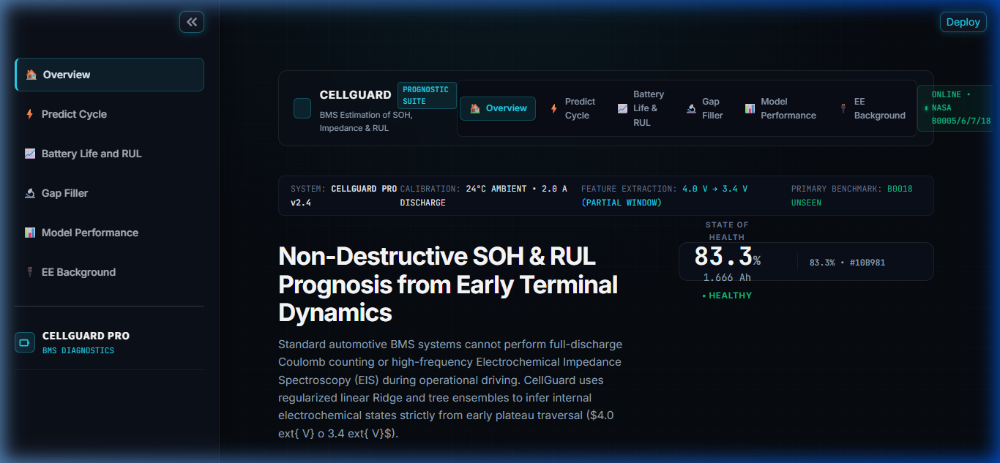
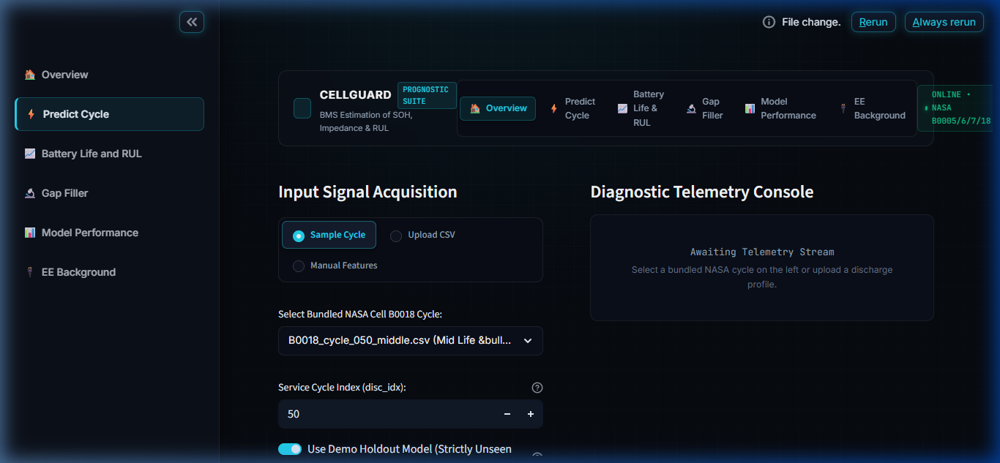
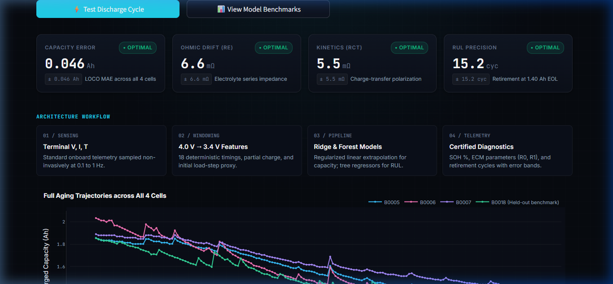
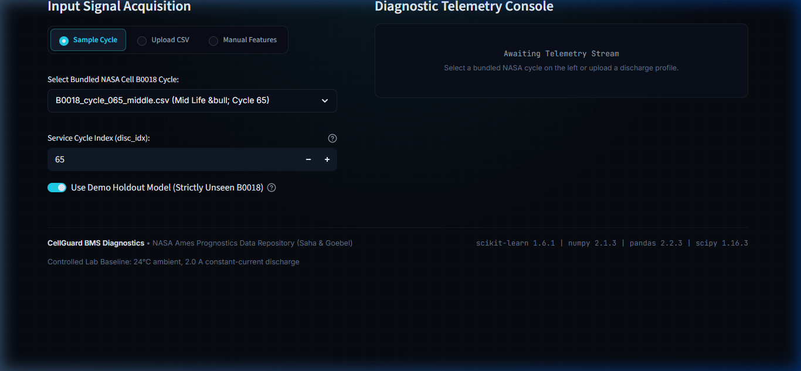
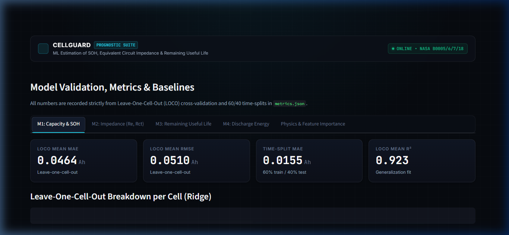
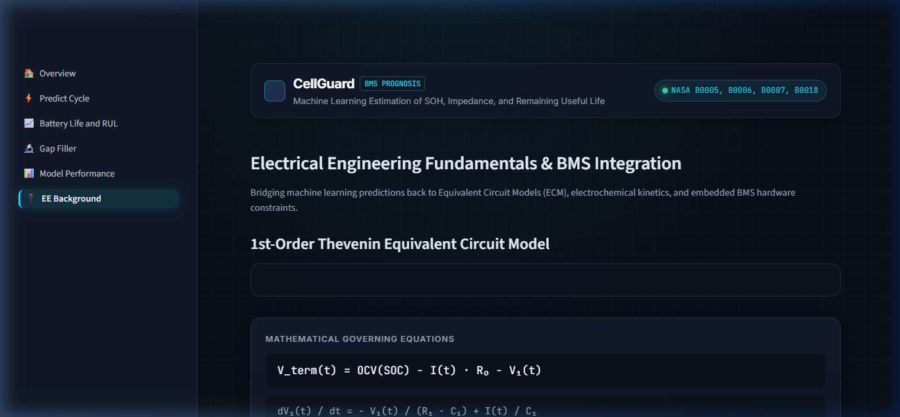

# CellGuard: Battery SOH, Impedance, and RUL Estimation

**EEE Final Year Project**: *Machine Learning-Based Estimation of Missing Electrical Parameters, State of Health and Remaining Useful Life of Lithium-Ion Batteries for BMS Applications Using NASA Data.*

[](https://www.python.org/downloads/)
[](https://scikit-learn.org/)
[](https://streamlit.io/)
[](tests/)

---

## 1. Project Overview

> **Model and validation details:** See [ML_README.md](ML_README.md) for the expanded-dataset training run, estimator choices, LOCO metrics (MAE, RMSE, R²), and known limitations.

This project treats lithium-ion cells as dynamic electrical components. Using terminal measurements that a standard Battery Management System (BMS) records non-invasively (terminal voltage, current, and surface temperature), machine learning pipelines estimate unobservable electrochemical states:

1. **M1 — Capacity (Ah) & State of Health (SOH %)**: Estimated exclusively from an early partial discharge window ($4.0\text{ V} \to 3.4\text{ V}$) without requiring deep depletion to cutoff.
2. **M2 — Ohmic ($R_e \approx R_0$) and Charge-Transfer ($R_{ct} \approx R_1$) Resistance**: Recovers missing impedance for operational cycles lacking Electrochemical Impedance Spectroscopy (EIS).
3. **M3 — Remaining Useful Life (RUL)**: Forecasts cycles remaining until the cell reaches the $1.40\text{ Ah}$ (30% capacity fade) End of Life (EOL) retirement threshold.
4. **M4 — Usable Discharge Energy (Wh)**: Estimates available energy from early voltage dynamics.

---

## 2. Directory Structure

```
battery-soh-rul/
├── README.md                          # Comprehensive project documentation
├── REPORT_NOTES.md                    # EEE viva defense notes & technical proofs
├── requirements.txt                   # Exact pinned dependencies from training run
├── .streamlit/
│   └── config.toml                    # Dark control-room theme configuration
├── data/                              # NASA Li-ion battery dataset (.mat files)
│   ├── B0005.mat
│   ├── B0006.mat
│   ├── B0007.mat
│   └── B0018.mat
├── src/
│   ├── battery_features.py            # Shared deterministic 18-feature extraction
│   └── inference.py                   # Production inference coordinator & error bands
├── models/                            # Trained model pickles and metrics (from Colab)
│   ├── model_capacity.pkl             # Ridge pipeline (18 partial window features)
│   ├── model_re.pkl                   # Ridge pipeline (18 features + capacity + disc_idx)
│   ├── model_rct.pkl                  # Ridge pipeline (18 features + capacity + disc_idx)
│   ├── model_rul.pkl                  # RandomForest pipeline (18 features + cap + slopes)
│   ├── model_energy.pkl               # Ridge pipeline for discharge Wh
│   ├── demo_holdout_B0018_models.pkl  # Bare pipelines trained on B0005/6/7 only
│   ├── feature_schema.json            # Feature definitions, bounds, and units
│   ├── feature_table.csv              # Extracted 636-cycle dataset
│   ├── ecm_reference.csv              # Exported parameter table for Thevenin ECM
│   └── metrics.json                   # Real recorded LOCO cross-validation metrics
├── app/
│   ├── streamlit_app.py               # Main diagnostic application with st.navigation
│   └── ui/
│       ├── theme.css                  # Dark lab control room CSS styles
│       ├── components.py              # SOH ring gauge, SVG battery, KPI cards
│       ├── charts.py                  # Plotly interactive dark-themed figures
│       └── pages/                     # Modular multi-page application
│           ├── overview.py            # Executive landing & workflow strip
│           ├── predict.py             # Single-cycle diagnostics & curve inspection
│           ├── life_rul.py            # Degradation scrubbing & trend extrapolation
│           ├── gap_filler.py          # Impedance gap-filling & masking simulation
│           ├── performance.py         # Full metrics audit & baseline bars
│           └── ee_background.py       # 1st-order Thevenin ECM schematic & math
├── tests/
│   ├── test_features.py               # Unit tests on synthetic curves & real B0005 data
│   └── test_round_trip.py             # Full round-trip test against sample cycles
├── sample_cycles/                     # Bundled B0018 raw discharge CSVs (early/mid/late)
├── figures/                           # Pre-rendered training figures & importances
└── docs/
    └── screenshots/                   # Application screenshots for report inclusion
```

---

## 3. Expanded Dataset Validation

The current models use 34 SHA-256-deduplicated NASA cells. Capacity, Rct, energy, and RUL use grouped Leave-One-Cell-Out (LOCO) validation. Re uses a chronological split within known cells: first 80% of cycles train, last 20% test. Its score applies to later-cycle predictions for cells with prior history, not entirely unseen cells. Detailed results are in `models/training_metrics.json`:

| Model Target | Estimator | Validation cells | MAE | MSE loss | RMSE | R² |
| :--- | :--- | :---: | :---: | :---: | :---: | :---: |
| **Capacity (Ah)** | Ridge Regression | 34 | **0.1042 Ah** | 0.02180 Ah² | 0.1477 Ah | 0.7635 |
| **State of Health (%)** | Derived from capacity | 34 | **5.21 percentage points** | 54.50 points² | 7.38 points | 0.7635 |
| **Ohmic Resistance ($R_e$)** | Extra Trees | 33 | **0.00266 $\Omega$** | 0.0000341 $\Omega^2$ | 0.00584 $\Omega$ | **0.9407** |
| **Charge-Transfer ($R_{ct}$)** | Ridge Regression | 34 | **0.01483 $\Omega$** | 0.0004391 $\Omega^2$ | 0.02096 $\Omega$ | 0.8336 |
| **Remaining Useful Life** | Random Forest | 17 | **19.31 cycles** | 709.40 cycles² | 26.63 cycles | 0.3709 |
| **Discharge Energy (Wh)** | Ridge Regression | 34 | **0.3483 Wh** | 0.23811 Wh² | 0.4880 Wh | 0.7807 |

RUL is a rough estimate and is evaluated only on cells with a valid observed 1.40 Ah crossing. Re's higher R² is from a within-cell forward split and should not be compared directly with unseen-cell LOCO scores. See [ML_README.md](ML_README.md) for feature preparation, model rationale, filters, and per-cell results.

---

## 4. Key Engineering Safeguards & Defensibility

1. **Partial-window capacity input**: Capacity and energy estimates use the early 4.0 V to 3.4 V discharge feature window; complete-discharge totals are not used as model inputs.
2. **Cell-grouped validation**: Validation holds out whole cells. It does not mix cycles from the same cell across a fold.
3. **Dataset quality filters**: Exact duplicate files and implausible capacity/EIS labels are excluded; filters are recorded in `models/training_metrics.json`.
4. **Validation scope**: Re's R² is 0.9407 for future cycles within known cell histories; it is not an unseen-cell score. RUL has only 17 eligible cells and a pooled MAE of about 19.3 cycles. See `ML_README.md` for limits.
5. **RUL end-of-life handling**: If predicted capacity is at or below 1.40 Ah, the app reports “End of life reached” rather than a cycle estimate.

---

## 5. Quickstart & Installation

### 5.1 Environment Setup
Install the application dependencies (scikit-learn is pinned to match the saved model artifacts):
```bash
cd battery-soh-rul
pip install -r requirements.txt
```

### 5.2 Launch the Streamlit Diagnostic Application
```bash
streamlit run app/streamlit_app.py
```
Open your browser at `http://localhost:8501`.

### 5.3 Deploy on Render

The repository is configured as a Render Blueprint using [`render.yaml`](render.yaml). It defines a Python web service that installs `requirements.txt` and launches `app/streamlit_app.py` on Render's assigned port. The root `.python-version` pins Python 3.12.11, and `.streamlit/config.toml` contains the app theme and Streamlit server settings.

1. Push the repository, including `data/`, `models/`, `render.yaml`, `.python-version`, and `.streamlit/config.toml`, to GitHub.
2. In Render, choose **New → Blueprint** and connect the GitHub repository and branch.
3. Render reads `render.yaml` and creates the CellGuard web service. Confirm the planned service, then deploy it.

No secrets or environment variables need to be added manually. The service binds to `0.0.0.0` and uses Render's `PORT` environment variable. Commits to the connected branch trigger new deploys.

### 5.4 Run Unit Tests
```bash
pytest -v
```
All unit tests in `tests/test_features.py` and `tests/test_round_trip.py` verify deterministic feature extraction and validate predictions against the sample cycle ground truth within LOCO error bounds.

---

## 6. Screenshots Gallery

| Overview Dashboard | Predict Cycle & SOH Gauge |
| :---: | :---: |
|  |  |

| Battery Life & RUL Horizon | Impedance Gap Filler |
| :---: | :---: |
|  |  |

| Model Performance & LOCO Validation | 1st-Order Thevenin Circuit & BMS Math |
| :---: | :---: |
|  |  |

---

## 7. Retraining

Install the dependencies in `requirements.txt`, keep the expanded NASA collection under `Battery_ML/5. Battery Data Set/`, then run `python src/train_models.py` from the repository root. This trains the current 34-cell models and refreshes `models/` artifacts and LOCO metrics. The notebooks retain the earlier four-cell experiment; use [ML_README.md](ML_README.md) for the current reproducible workflow.

---

## 8. Dataset Citation
- **NASA Ames Prognostics Center of Excellence (PCoE)**: B. Saha and K. Goebel (2007). *Battery Data Set*, NASA Ames Research Center, Moffett Field, CA.
