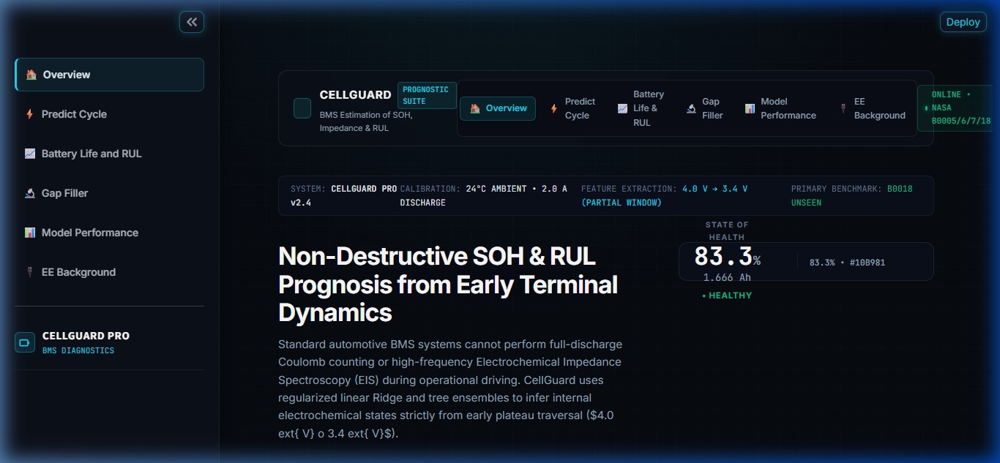
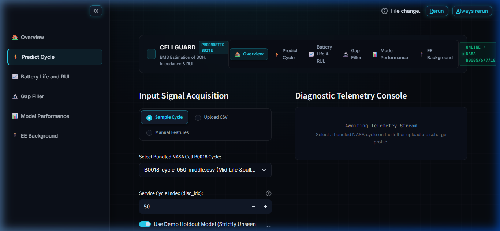
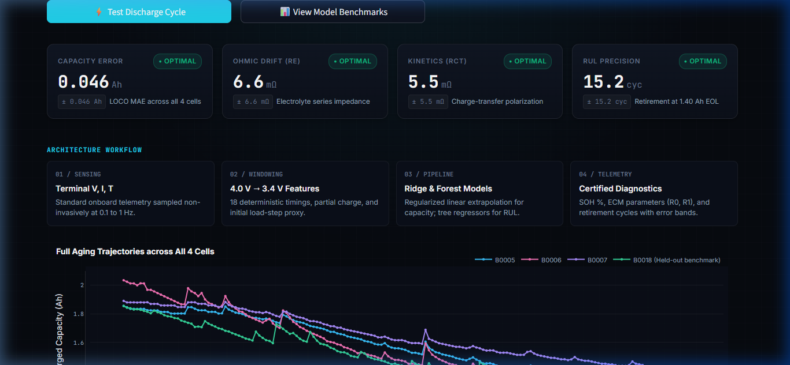
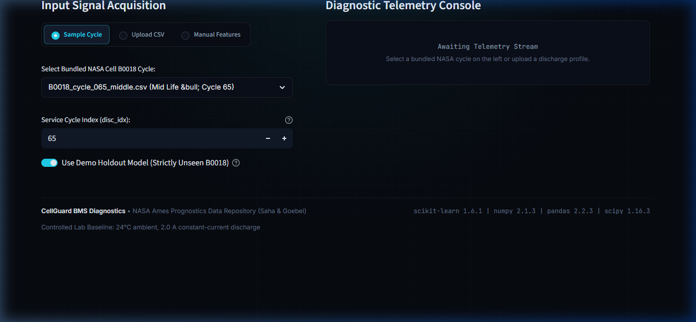
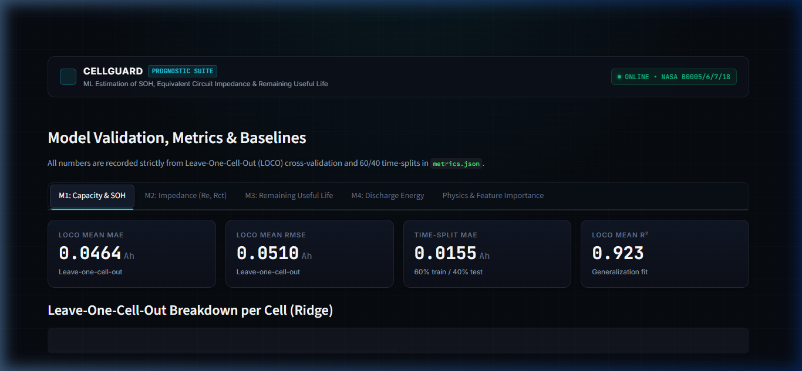
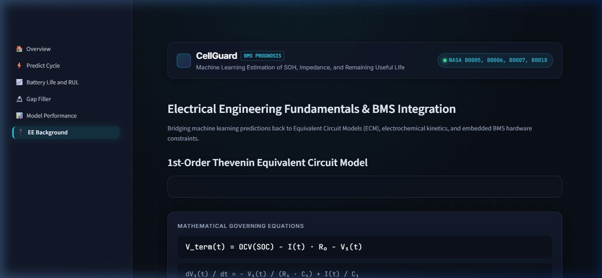

# CellGuard: Battery SOH, Impedance, and RUL Estimation

**EEE Final Year Project**: *Machine Learning-Based Estimation of Missing Electrical Parameters, State of Health and Remaining Useful Life of Lithium-Ion Batteries for BMS Applications Using NASA Data.*

[](https://www.python.org/downloads/)
[](https://scikit-learn.org/)
[](https://streamlit.io/)
[](tests/)

---

## 1. Project Overview

This project treats lithium-ion cells as dynamic electrical components. Using terminal measurements that a standard Battery Management System (BMS) records non-invasively (terminal voltage, current, and surface temperature), machine learning pipelines estimate unobservable electrochemical states:

1. **M1 — Capacity (Ah) & State of Health (SOH %)**: Estimated exclusively from an early partial discharge window ($4.0\text{ V} \to 3.4\text{ V}$) without requiring deep depletion to cutoff.
2. **M2 — Ohmic ($R_e \approx R_0$) and Charge-Transfer ($R_{ct} \approx R_1$) Resistance**: Recovers missing impedance for operational cycles lacking Electrochemical Impedance Spectroscopy (EIS).
3. **M3 — Remaining Useful Life (RUL)**: Forecasts cycles remaining until the cell reaches the $1.40\text{ Ah}$ (30% capacity fade) End of Life (EOL) retirement threshold.
4. **M4 — Usable Discharge Energy (Wh)**: Estimates available energy from early voltage dynamics.

---

## 2. Directory Structure

```
battery-soh-rul/
├── README.md                          # Comprehensive project documentation
├── REPORT_NOTES.md                    # EEE viva defense notes & technical proofs
├── requirements.txt                   # Exact pinned dependencies from training run
├── .streamlit/
│   └── config.toml                    # Dark control-room theme configuration
├── data/                              # NASA Li-ion battery dataset (.mat files)
│   ├── B0005.mat
│   ├── B0006.mat
│   ├── B0007.mat
│   └── B0018.mat
├── src/
│   ├── battery_features.py            # Shared deterministic 18-feature extraction
│   └── inference.py                   # Production inference coordinator & error bands
├── models/                            # Trained model pickles and metrics (from Colab)
│   ├── model_capacity.pkl             # Ridge pipeline (18 partial window features)
│   ├── model_re.pkl                   # Ridge pipeline (18 features + capacity + disc_idx)
│   ├── model_rct.pkl                  # Ridge pipeline (18 features + capacity + disc_idx)
│   ├── model_rul.pkl                  # RandomForest pipeline (18 features + cap + slopes)
│   ├── model_energy.pkl               # Ridge pipeline for discharge Wh
│   ├── demo_holdout_B0018_models.pkl  # Bare pipelines trained on B0005/6/7 only
│   ├── feature_schema.json            # Feature definitions, bounds, and units
│   ├── feature_table.csv              # Extracted 636-cycle dataset
│   ├── ecm_reference.csv              # Exported parameter table for Thevenin ECM
│   └── metrics.json                   # Real recorded LOCO cross-validation metrics
├── app/
│   ├── streamlit_app.py               # Main diagnostic application with st.navigation
│   └── ui/
│       ├── theme.css                  # Dark lab control room CSS styles
│       ├── components.py              # SOH ring gauge, SVG battery, KPI cards
│       ├── charts.py                  # Plotly interactive dark-themed figures
│       └── pages/                     # Modular multi-page application
│           ├── overview.py            # Executive landing & workflow strip
│           ├── predict.py             # Single-cycle diagnostics & curve inspection
│           ├── life_rul.py            # Degradation scrubbing & trend extrapolation
│           ├── gap_filler.py          # Impedance gap-filling & masking simulation
│           ├── performance.py         # Full metrics audit & baseline bars
│           └── ee_background.py       # 1st-order Thevenin ECM schematic & math
├── tests/
│   ├── test_features.py               # Unit tests on synthetic curves & real B0005 data
│   └── test_round_trip.py             # Full round-trip test against sample cycles
├── sample_cycles/                     # Bundled B0018 raw discharge CSVs (early/mid/late)
├── figures/                           # Pre-rendered training figures & importances
└── docs/
    └── screenshots/                   # Application screenshots for report inclusion
```

---

## 3. Verified Performance Metrics (from `models/metrics.json`)

All metrics below are recorded directly from Leave-One-Cell-Out (LOCO) cross-validation:

| Model Target | Deployed Algorithm | Cross-Validation Scheme | Mean LOCO MAE | Headline Unseen Cell (B0018) | Conventional Baseline MAE |
| :--- | :--- | :--- | :---: | :---: | :---: |
| **Capacity (Ah)** | **Ridge Regression** | Leave-One-Cell-Out (4 folds) | **0.0464 Ah** | **0.0142 Ah** | Coulomb Counting: 0.0131 Ah *(needs full cutoff)* |
| **State of Health (%)** | **Ridge Regression** | Leave-One-Cell-Out (4 folds) | **2.32 %** | **0.71 %** | Training Mean Fill: 8.59 % |
| **Ohmic Resistance ($R_e$)** | **Ridge Regression** | Leave-One-Cell-Out (4 folds) | **0.0066 $\Omega$** | **0.0041 $\Omega$** | Linear Interp: 0.0007–0.0012 $\Omega$ *(within-cell)* |
| **Charge-Transfer ($R_{ct}$)** | **Ridge Regression** | Leave-One-Cell-Out (4 folds) | **0.0055 $\Omega$** | **0.0057 $\Omega$** | Linear Interp: 0.0011–0.0015 $\Omega$ |
| **Remaining Useful Life** | **Random Forest** | Leave-One-Cell-Out (4 folds) | **15.23 cycles** | **7.71 cycles** | Polynomial Extrapolation |
| **Discharge Energy (Wh)** | **Ridge Regression** | Leave-One-Cell-Out (4 folds) | **0.1476 Wh** | **0.0820 Wh** | Full Energy Integration *(needs cutoff)* |

---

## 4. Key Engineering Safeguards & Defensibility

1. **Zero Label Leakage in M1**:
   The capacity model strictly uses features extracted from the $4.0\text{ V} \to 3.4\text{ V}$ window. Total discharge time, discharge energy to cutoff, and minimum voltage are completely excluded, ensuring the model functions under partial discharge scenarios without trivial identity leakage.
2. **Leave-One-Cell-Out (LOCO) Cross-Validation**:
   No random splitting across cycles. Cycles from the same cell are never mixed between training and validation. Cell B0018 serves as the primary unseen benchmark.
3. **Linear Extrapolation with Ridge**:
   Under a 60/40 time-split, Ridge achieves an MAE of **0.0155 Ah**, outperforming decision tree ensembles (**0.0985 Ah** for GradientBoosting), which cannot extrapolate to lower capacities than seen during training.
4. **Honest Gap-Filling Findings**:
   Within a single cell, linear interpolation beats cross-cell ML for small random dropouts (10% and 20%) due to smooth degradation. Machine learning wins specifically for **large contiguous block dropouts (15+ cycles)** and **30% $R_{ct}$ masking**.
5. **RUL Post-EOL Protection**:
   The RUL model was trained exclusively on active pre-EOL cycles. When a cycle's predicted capacity drops to $\le 1.40\text{ Ah}$, the system displays **"End of life reached"** instead of an out-of-distribution cycle count.

---

## 5. Quickstart & Installation

### 5.1 Environment Setup
Install the pinned dependencies matching the Colab training environment:
```bash
cd battery-soh-rul
pip install -r requirements.txt
```

### 5.2 Launch the Streamlit Diagnostic Application
```bash
streamlit run app/streamlit_app.py
```
Open your browser at `http://localhost:8501`.

### 5.3 Run Unit Tests
```bash
pytest -v
```
All unit tests in `tests/test_features.py` and `tests/test_round_trip.py` verify deterministic feature extraction and validate predictions against the sample cycle ground truth within LOCO error bounds.

---

## 6. Screenshots Gallery

| Overview Dashboard | Predict Cycle & SOH Gauge |
| :---: | :---: |
|  |  |

| Battery Life & RUL Horizon | Impedance Gap Filler |
| :---: | :---: |
|  |  |

| Model Performance & LOCO Validation | 1st-Order Thevenin Circuit & BMS Math |
| :---: | :---: |
|  |  |

---

## 7. Retraining in Google Colab

The pipeline is 100% reproducible:
1. Open Google Colab and upload `notebooks/train_battery_models.ipynb`.
2. Upload the 4 cell files (`B0005.mat`, `B0006.mat`, `B0007.mat`, `B0018.mat`) to Google Drive at `My Drive/Battery_ML/data/`.
3. Select **Runtime &rarr; Run all**. The notebook executes data extraction, LOCO cross-validation, feature importance, and exports `battery_artifacts.zip` in under 15 minutes.
4. Unzip `battery_artifacts.zip` into `models/`, `figures/`, and `sample_cycles/`.

---

## 8. Dataset Citation
- **NASA Ames Prognostics Center of Excellence (PCoE)**: B. Saha and K. Goebel (2007). *Battery Data Set*, NASA Ames Research Center, Moffett Field, CA.
